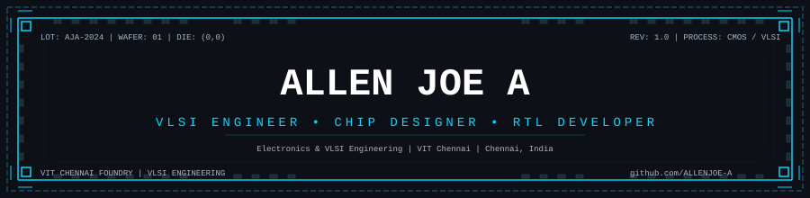
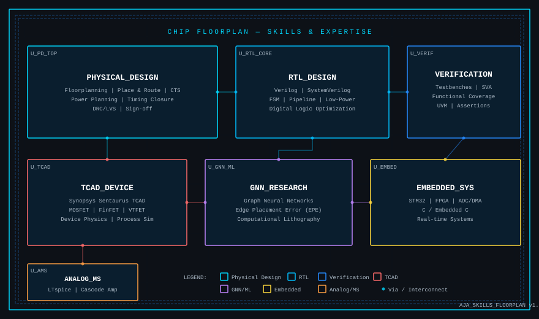
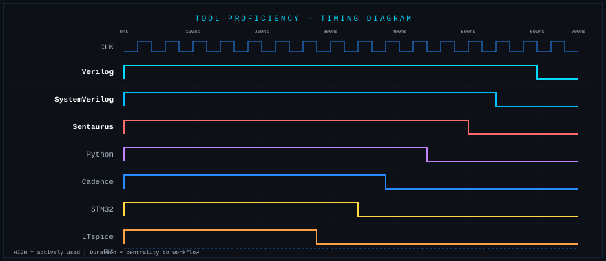
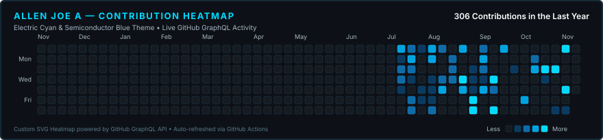

<div align="center">

<!-- Die-shot / reticle header banner -->


<!-- Typing Animation Effect -->
<a href="https://readme-typing-svg.demolab.com"></a>

</div>

<br/>

## About Me

```verilog
// ──────────────────────────────────────────────────────────────
//  Module:  allen_joe_engineer
//  Domain:  ASIC / Physical Design, RTL, TCAD & EDA Research
// ──────────────────────────────────────────────────────────────

module allen_joe_engineer #(
  parameter string NAME        = "Allen Joe A",
  parameter string LOCATION    = "Chennai, India",
  parameter string INSTITUTION = "VIT Chennai",
  parameter string DEGREE      = "B.Tech in Electronics & Communication (VLSI Focus)"
)(
  input  wire        clk,
  input  wire        rst_n,
  output reg  [7:0]  pipeline_stage
);

  // ── Core Engineering Disciplines ───────────────────────────
  wire  asic_pd_flow;       // OpenROAD / Cadence: Floorplanning, CTS, P&R, STA
  wire  rtl_design;         // Verilog & SystemVerilog: Microarchitecture, FSM, DMA
  wire  vlsi_testing;       // DFT: BIST Architectures, LFSR, Fault Coverage
  wire  tcad_modeling;      // Synopsys Sentaurus: 2D/3D VTFET & Biosensor Simulation
  wire  computational_ai;   // EDA AI: CNN Hotspot Detection, GNN-T EPE Prediction
  wire  embedded_systems;   // STM32, ARM Cortex-M, High-Speed ADC/DMA

  // ── Data Path Integration ──────────────────────────────────
  assign pipeline_stage = {asic_pd_flow,
                           rtl_design,
                           vlsi_testing,
                           tcad_modeling,
                           computational_ai,
                           embedded_systems,
                           2'b00};

  // ── Sequential State Update ────────────────────────────────
  always @(posedge clk or negedge rst_n) begin
    if (!rst_n)
      pipeline_stage <= 8'h00;
    else
      pipeline_stage <= pipeline_stage + 1'b1;
  end

endmodule
```

<br/>

## Chip Floorplan &#x2014; Skills & Expertise

<div align="center">



</div>

<br/>

## Tools & Technologies &#x2014; Timing Diagram

<div align="center">



</div>

<br/>

## Engineering Log &#x2014; Featured Projects

| Project | Domain | Status | Key Highlights | Repository |
|:---|:---|:---:|:---|:---:|
| **Gain-Scheduled ADPLL** | Mixed-Signal / RTL | `RTL Implemented` | Dual-mode gain-scheduled DLF with sub-100 cycle lock (85 cycles sim); OpenROAD / SkyWater 130nm synthesis flow | [Repo](https://github.com/ALLENJOE-A/Gear-Shifting-All-Digital-Phase-Locked-Loop) |
| **Low-Power MAC BIST** | DFT / VLSI Testing | `Simulation & Synthesis` | Comparative PPA & fault coverage evaluation across LFSR/BIST architectures for 16-bit MAC | [Repo](https://github.com/ALLENJOE-A/Low-Power-MAC-BIST-PPA-Fault-Coverage) |
| **Adaptive Burst DMA Controller** | ASIC & RTL Design | `RTL Verified` | 4-channel DMA with round-robin arbitration, dynamic burst sizing (1/4/8/16-word), and hardware performance monitoring | [Repo](https://github.com/ALLENJOE-A/4-Channel-Adaptive-Burst-DMA-Controller-with-Hardware-Performance-Monitoring) |
| **Explainable Lithography Hotspot Detection** | AI in EDA / Lithography | `Research Prototype` | CNN layout classifier with Grad-CAM gradient saliency maps for layout pinch/bridge detection on ICCAD-12 benchmarks | [Repo](https://github.com/ALLENJOE-A/CNN-Driven-Explainable-AI-for-Lithography-Hotspot-Detection) |
| **Pocket-Engineered Vertical TFET** | Device Modelling / TCAD | `Simulation Completed` | Synopsys Sentaurus TCAD device optimization with narrow-bandgap heterojunction source pocket and high-k dielectrics | [Repo](https://github.com/ALLENJOE-A/DG-Source-Pocket-Engineered-Vertical-TFET) |
| **GNN-T Edge Placement Error Prediction** | Computational Litho / ML | `Research Prototype` | Graph Neural Network + Transformer architecture forecasting sub-resolution EPE from layout graphs using 2D Fourier-optics simulation | [Repo](https://github.com/ALLENJOE-A/GNN-T_Edge-Error-Prediction-for-Computational-Lithography) |

> **Additional Project Case Studies:**  
> • **FE-DGDM-JLTFET Biosensor TCAD**: Ferroelectric negative-capacitance junctionless TFET biomolecule sensor — [`Simulation Completed`](https://github.com/ALLENJOE-A/FE-DGDM-JLTFET-Biosensor-TCAD)  
> • **STM32 Digital Oscilloscope**: Real-time dual ADC interleaved sampling & ILI9341 display — [`Hardware & Firmware Completed`](https://github.com/ALLENJOE-A/Digital-Oscilloscope-STM32)  
> • **Cascode Differential Amplifier**: Mosfet wide-swing cascode high-gain analog amplifier in LTspice — `Simulation Completed (Private Academic Repo)`  
> • **Interactive Semiconductor Portfolio Website**: 3D chip progression & verified research case studies — [`Live Site`](https://github.com/ALLENJOE-A/semiconductor-portfolio)  
>  
> *Note on implementation statuses: Statuses accurately reflect RTL/FPGA implementation, TCAD device simulation, and research prototypes. No silicon tapeouts are claimed without physical foundry manufacturing evidence.*

<br/>

## GitHub Statistics

<div align="center">


</div>

<br/>

## Contribution Activity

<div align="center">

<!-- Custom Cyan/Blue Contribution Heatmap -->


<p style="color:#AAB8C5;font-size:12px;margin-top:6px;margin-bottom:20px;">
  <em>Custom contribution heatmap generated from GitHub GraphQL API data using an Electric Cyan (#00D9FF) and Semiconductor Blue (#268BFF) intensity scale. Auto-refreshed daily via GitHub Actions.</em>
</p>

<!-- Activity Graph (last 31 days) -->


<br/><br/>

<!-- Snake Contribution Grid Animation -->
<picture>
  <source media="(prefers-color-scheme: dark)" srcset="https://raw.githubusercontent.com/ALLENJOE-A/ALLENJOE-A/output/github-contribution-grid-snake-dark.svg" />
  <source media="(prefers-color-scheme: light)" srcset="https://raw.githubusercontent.com/ALLENJOE-A/ALLENJOE-A/output/github-contribution-grid-snake.svg" />
  
</picture>

</div>

<br/>

## Connect

<div align="center">

<a href="https://github.com/ALLENJOE-A">
  
</a>
<a href="https://www.linkedin.com/in/allenjoe-a" target="_blank">
  
</a>
<a href="mailto:allenjoe.a2024@vitstudent.ac.in">
  
</a>

<br/><br/>


</div>
